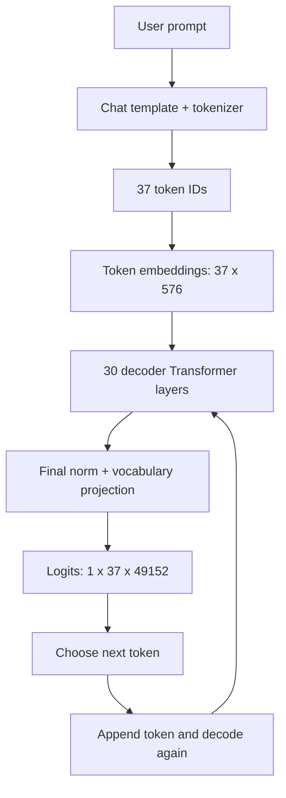

# LLM Inference Architecture — Hands-on Notes

**Setup:** Hugging Face `HuggingFaceTB/SmolLM2-135M-Instruct` · NVIDIA RTX 5050 (7.96 GB VRAM) · PyTorch CUDA 12.8 · FP16 · Windows

> These notes are based on a successful local inference run. The model was loaded from `E:\Hosted LLM\models\smollm2-135m`.

## 1. End-to-end inference pipeline



**What actually happens:**
1. A *chat template* converts the user message into the model's expected conversation format, including special tokens.
2. The tokenizer produces **37 token IDs** for the example prompt and chat formatting.
3. Embeddings turn each token ID into a **576-dimensional** hidden vector.
4. **30 Transformer layers** update the hidden representations using masked self-attention and feed-forward networks (with normalization and residual connections).
5. Final hidden states are projected to **49,152 vocabulary scores** (logits) per position.
6. The logits at the **last position** predict the next token; generation repeats for subsequent tokens.

The demo is a **decoder-only** model. In causal attention, a token can use earlier tokens and itself, not future tokens.

## 2. Real measurements from the run

| Output | Measured value | Interpretation |
|---|---:|---|
| GPU | RTX 5050 | Inference device |
| VRAM capacity | 7.96 GB | Physical GPU memory reported |
| Loaded model tensors | 256.59 MiB | Approximate live tensor allocation after loading |
| Input length | 37 tokens | Chat-template-formatted prompt |
| Logits shape | `[1, 37, 49152]` | `[batch, positions, vocabulary]` |
| First predicted token | ID `34505` → `Artificial` | Greedy prediction from final-position logits |
| Transformer layers | 30 | Each has its own attention computation and KV cache |
| Query heads | 9 | Attention query heads per layer |
| KV heads | 3 | Key and value heads per layer (GQA) |
| Head dimension | 64 | Vector length per head |
| Layer-0 K shape | `[1, 3, 37, 64]` | `[batch, kv_heads, tokens, head_dim]` |
| Layer-0 V shape | `[1, 3, 37, 64]` | Same structure |
| Total prompt KV cache | 0.813 MiB | Raw K+V tensor data across 30 layers |
| Generated tokens | 100 | Hit `max_new_tokens=100`; response may be incomplete |
| Allocated at end | 269.01 MiB | Includes other still-live tensors, not just weights |
| Peak allocated | 273.30 MiB | Max PyTorch live CUDA tensor allocation |
| Reserved at end | 292.00 MiB | Memory held by PyTorch allocator for reuse |

**Note:** MiB means 1,048,576 bytes. PyTorch's `memory_allocated()` and `memory_reserved()` do not represent every byte used by the GPU, such as all driver/runtime allocations.

## 3. Attention: what Q, K and V mean

For each Transformer layer, token hidden representations are projected using **learned weight matrices**:

- **Q (Query):** What information does this position seek?
- **K (Key):** What can each available position be matched against?
- **V (Value):** What information is returned/combined from each position?

```text
Hidden representation X (576 dimensions per token)
         |              |              |
      W_Q projection  W_K projection  W_V projection
         |              |              |
     9 Q heads       3 K heads       3 V heads
     9 x 64          3 x 64          3 x 64
         \              |              /
          --> compare Q·K, softmax, weighted sum of V -->
                 context-aware representation
```

The simplified attention equation is:

\[
\operatorname{Attention}(Q,K,V) = \operatorname{softmax}\!\left(\frac{QK^{T}}{\sqrt{d_k}} + M\right)V
\]

`M` represents causal masking (positions cannot attend to future positions). An attention output is **not** the final word; the representation still goes through later computations and the vocabulary projection.

### Real projection matrix shapes

| Matrix | Weight shape | Why |
|---|---|---|
| `q_proj.weight` | `[576, 576]` | 9 query heads × 64 dimensions |
| `k_proj.weight` | `[192, 576]` | 3 key heads × 64 dimensions |
| `v_proj.weight` | `[192, 576]` | 3 value heads × 64 dimensions |

In PyTorch linear layers, a weight has shape `[output_features, input_features]`.

### Grouped Query Attention (GQA)

```text
Q1 Q2 Q3  ──> K1 and V1
Q4 Q5 Q6  ──> K2 and V2
Q7 Q8 Q9  ──> K3 and V3
```

The model has **9 Q heads but only 3 KV heads**, so three query heads share one KV head pair. Compared with a hypothetical 9-KV-head design with the same head dimension and precision, **KV tensor storage is reduced by 2/3**. This does **not** mean the entire model uses 2/3 less GPU memory.

## 4. Why KV cache is different from model weights

| Model weights | KV cache |
|---|---|
| Learned during training | Computed from the current input sequence |
| Loaded into GPU memory when model starts | Built as tokens are processed |
| Usually unchanged during inference | Grows with processed sequence length |
| Reused across requests | Logically associated with each active generation |
| Examples: `W_Q`, `W_K`, `W_V` | Resulting **K and V tensors**, per layer |

**Analogy:** Weights are the reusable machinery; the KV cache is temporary, request-specific working data produced by that machinery.

**Why not cache Q?** In ordinary autoregressive decoding, the model needs the **new token's Query** to compare against **previous Keys** and combine **previous Values**. Historical Query vectors are generally not needed for the next token's attention.

## 5. Why each Transformer layer has a different KV cache

A layer receives transformed hidden states from the preceding layer and has its **own learned K/V projection weights**. Thus its K/V representations are different. Your 30-layer model keeps **30 pairs of K and V tensors** for the active sequence.

For one layer, your observed shapes were:

```text
K: [1, 3, 37, 64]
V: [1, 3, 37, 64]
```

With FP16 (2 bytes/value), cache size is:

```text
30 layers × 2 (K and V) × 3 KV heads × 37 tokens
          × 64 values/head × 2 bytes/value
= 852,480 bytes ≈ 0.813 MiB
```

Each extra processed token adds approximately:

```text
30 × 2 × 3 × 1 × 64 × 2 = 23,040 bytes ≈ 0.02197 MiB
```

This is **raw KV tensor payload only**. Actual serving memory usage also includes allocator overhead, intermediate tensors, model weights, buffers, and potentially other caches.

## 6. Prefill vs decoding

```text
PREFILL
37 prompt tokens --> model forward pass --> K/V stored for 37 positions
                                           --> next-token logits

DECODE
Sample next token --> process that new token using cached K/V
                  --> append its new K/V --> next-token logits
                  --> repeat until stop condition
```

- **Prefill:** Computes representations for prompt tokens, building their KV cache.
- **Decode:** Usually processes one new token at a time while reusing prior K/V.
- **Sequence length and KV memory:** Grow roughly linearly with processed token count for this architecture.
- A generated final token might **not yet be in the cache** when generation stops; exact final cache length depends on the implementation.
- The observed **100 generated tokens** were limited by `max_new_tokens=100`; that does not guarantee the response finished naturally.

## 7. GPU memory and script lifetime

```text
Disk (E: drive): checkpoint/model files
         |
         v  load once
GPU VRAM: model weights (~256.59 MiB of live tensors)
         |
         +--> inference temporary tensors + logits
         +--> K/V cache on GPU during generation
```

- `model.to("cuda")` places model tensors on the GPU; it does **not** offload weights to CPU.
- `inputs.to("cuda")` places input tensors on the GPU.
- The script loads the model, runs a forward pass and then **a separate** `generate()` call; these do **not** share the same generation cache automatically.
- The code retains references to the first pass's `outputs` and `cache`, so some temporary tensors remain allocated at the final memory measurement.
- When the **Python process exits**, its CUDA allocations are released; running the script once is **not persistent hosting**.
- A long-running inference server loads weights once and handles repeated requests without reloading the checkpoint.

Useful measurements:

```python
print(torch.cuda.memory_allocated() / 1024**2)     # live tensor allocation, MiB
print(torch.cuda.memory_reserved() / 1024**2)      # CUDA allocator reservation, MiB
print(torch.cuda.max_memory_allocated() / 1024**2) # peak live allocation, MiB
```

From another terminal while the process runs:

```powershell
nvidia-smi -l 1
```

## 8. Multi-user inference: the next topic

```text
             Shared model weights
                /     |     \
            User A  User B  User C
              |       |       |
             KV A    KV B    KV C
```

- **Weights are shared** by requests handled within one loaded model instance.
- **KV state is logically separate** for each active generation; in some engines, safe prefix sharing and block-based allocation are possible.
- Admission control, queues, batching, and GPU memory limits are **server/scheduler responsibilities**, not automatic properties of a simple Python script.
- In a production engine like vLLM, continuous batching and paged KV allocation improve GPU utilization and memory management.

## 9. Interview-ready answers

**How do you host a Hugging Face LLM?**  
Load tokenizer and model weights at server startup, put model tensors on a compatible GPU, expose an inference endpoint, and use an inference engine/scheduler for request concurrency, memory limits, batching, monitoring and timeouts.

**Where is the KV cache stored?**  
Usually in **GPU VRAM** during GPU inference, separately from model weights; it contains per-layer K/V tensors for active sequences. Some inference engines can offload or manage it across memory tiers.

**Why does KV cache grow?**  
Newly processed tokens add new key and value vectors for each Transformer layer. In this model, raw KV storage is linear in cached tokens.

**Why not share a single KV cache across users?**  
Different requests have different token histories, so each needs its own logical attention state. Model weights are shared, but users' histories must not be mixed.

**What makes GQA useful?**  
Several query heads share fewer K/V heads, lowering KV cache size and associated memory bandwidth versus standard multi-head attention with the same number of query and KV heads.

**What comes next?**  
1. Turn the script into a persistent single-worker FastAPI inference service.
2. Inspect VRAM before, during and after each request.
3. Send concurrent requests; observe latency, queuing and resource contention.
4. Compare against a production inference engine such as vLLM.

---

**Source of measurements:** Local `test-infrence.py` output from this project. Numbers are specific to the demonstrated model, input length, datatype, and run; they are not universal LLM constants.
